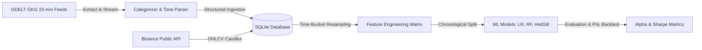

# GDELT News Database & Bitcoin Price Prediction Pipeline

An end-to-end data pipeline and machine learning system that ingests global news events from **GDELT (Global Database of Events, Language, and Tone)**, classifies articles into market-relevant taxonomies, stores them in a high-performance SQLite database, engineers time-series features aligned with **Bitcoin (BTC/USDT)** market data, and trains predictive ML models without lookahead bias.

---

## 1. Architecture Overview



### News Categorization Taxonomy
Each news article is tagged with a primary category and secondary tags based on URL paths, extracted titles, GDELT themes (e.g., `EPU_POLICY`, `WB_JUSTICE`, `TAX_FNCACT`), and key entities:
1. `Crypto_Blockchain`: Bitcoin, Ethereum, Solana, DeFi, stablecoins, miners, exchanges.
2. `Monetary_Policy`: Central banks, Jerome Powell, interest rates, rate cuts/hikes, inflation, CPI, FOMC.
3. `Regulation_Legal`: SEC, CFTC, court cases, lawsuits, bans, AML/KYC, ETF decisions.
4. `Macroeconomics`: GDP, jobs, unemployment, recession, fiscal debt, trade deficits.
5. `Geopolitics_Conflict`: Wars, military conflicts, international sanctions, political crises.
6. `Tech_Cybersecurity`: Cyberattacks, hacks, ransomware, exploits, AI developments.
7. `Energy_Commodities`: Crude oil, gold, silver, natural gas, power grids.
8. `Equities_FinancialMarkets`: S&P 500, Nasdaq, Wall Street, banking stress, earnings.
9. `General_News`: General politics, science, sports, and culture.

---

## 2. Directory Structure

```
├── config.py           # Database paths, categories, URLs, and headers
├── database.py         # SQLite connection, table schemas, and batch inserts
├── classifier.py       # Regex and theme-based news taxonomy categorizer
├── gdelt_fetcher.py    # GDELT Global Knowledge Graph (GKG) fetcher and parser
├── btc_fetcher.py      # Binance BTC/USDT OHLCV price fetcher
├── features.py         # Time-bucket aggregator & target variable builder
├── train.py            # Chronological ML training, backtester, and feature evaluator
├── main.py             # Unified CLI runner
├── requirements.txt    # Python dependencies
└── data/
    ├── crypto_news_alpha.db        # SQLite database
    ├── gdelt_news_categorized.csv  # Exported news dataset
    └── btc_prices_ohlcv.csv        # Exported BTC price series
```

---

## 3. Quick Start

### Run the Pipeline
```bash
# 1. Initialize DB, fetch BTC prices, and ingest recent GDELT batches
.venv/bin/python3 main.py --init-db --fetch-btc 500 --fetch-news 4

# 2. View database statistics and category distribution
.venv/bin/python3 main.py --stats

# 3. Export tables to CSV
.venv/bin/python3 main.py --export-csv

# 4. Train predictive models & backtest trading strategy
.venv/bin/python3 main.py --train
```

---

## 4. Feature Engineering for ML Training

| Feature Group | Description |
|---|---|
| **Category Volume** | `vol_{cat}`: Article count per category in each hourly interval |
| **Category Tone** | `tone_{cat}`: Average tone score (-100 to +100) per category |
| **Sentiment Polarities** | `pos_{cat}`, `neg_{cat}`, `pol_{cat}`: Emotional polarity and valence |
| **Attention Share** | `share_{cat}`: Proportion of global media attention on that category |
| **Market Volatility** | `btc_volatility_6h`, `btc_volatility_24h`, `btc_hl_spread` |
| **Prediction Targets** | `target_direction` (1 if next return > 0 else 0), `target_next_return` |
