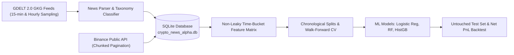

# GDELT News Database & Bitcoin Price Prediction Pipeline

An end-to-end quantitative data pipeline and machine learning system that ingests global news events from **GDELT (Global Database of Events, Language, and Tone)**, classifies articles into financial taxonomies, stores them in an indexed SQLite database, aligns the data with **Bitcoin (BTC/USDT)** historical price candles, and trains predictive ML models without lookahead bias.

---

## 1. Architecture Overview



### News Categorization Taxonomy
Each news article is tagged with a primary category and secondary tags based on URL paths, extracted titles, GDELT themes (e.g., `EPU_POLICY`, `WB_JUSTICE`, `TAX_FNCACT`), and key entities:
1. `Crypto_Blockchain`: Bitcoin, Ethereum, Solana, DeFi, stablecoins, miners, exchanges.
2. `Monetary_Policy`: Central banks, Jerome Powell, interest rates, rate cuts/hikes, inflation, CPI, FOMC.
3. `Regulation_Legal`: SEC, CFTC, court cases, lawsuits, bans, AML/KYC, ETF decisions.
4. `Macroeconomics`: GDP, jobs, unemployment, recession, fiscal debt, trade deficits.
5. `Geopolitics_Conflict`: Wars, military conflicts, international sanctions, political crises.
6. `Tech_Cybersecurity`: Cyberattacks, hacks, ransomware, exploits, AI developments.
7. `Energy_Commodities`: Crude oil, gold, silver, natural gas, power grids.
8. `Equities_FinancialMarkets`: S&P 500, Nasdaq, Wall Street, banking stress, earnings.
9. `General_News`: General politics, science, sports, and culture.

---

## 2. Directory Structure

```
├── config.py           # Database paths, categories, URLs, and backtest cost parameters
├── database.py         # SQLite connection (WAL mode), table schemas, and batch inserts
├── classifier.py       # Regex and theme-based news taxonomy categorizer
├── gdelt_fetcher.py    # GDELT GKG fetcher, parser, retry logic, and historical hourly sampler
├── btc_fetcher.py      # Binance paginated OHLCV fetcher with rate-limiting & gap detection
├── features.py         # Non-leaky time-bucket aggregator, technical indicators, and target builder
├── train.py            # Chronological splits, walk-forward validation, threshold tuning, and backtest
├── main.py             # Unified CLI runner
├── requirements.txt    # Python dependencies
└── data/
    ├── crypto_news_alpha.db        # SQLite database
    ├── gdelt_news_categorized.csv  # Exported news dataset
    └── btc_prices_ohlcv.csv        # Exported BTC price series
```

---

## 3. CLI Commands & Options

```bash
# 1. Fetch 5,000 historical BTC candles (~7 months of continuous hourly data)
.venv/bin/python3 main.py --fetch-btc 5000

# 2. Ingest 24 hourly sampled GDELT batches across the past 24 hours (with finance filter)
.venv/bin/python3 main.py --news-sample-hours 24 --filter-finance

# 3. View database summary, date ranges, and category breakdown
.venv/bin/python3 main.py --stats

# 4. Train models with 1-hour prediction horizon and feature coverage diagnostics
.venv/bin/python3 main.py --train --horizon 1 --diagnose-features

# 5. Train models with 4-hour prediction horizon
.venv/bin/python3 main.py --train --horizon 4

# 6. Real-time Live Signal: Check BUY, SELL, or WAIT recommendation right now
.venv/bin/python3 main.py --signal
.venv/bin/python3 main.py --signal --horizon 4

# 7. Export database tables to CSV
.venv/bin/python3 main.py --export-csv
```

---

## 4. Modeling Workflow & Best Practices

1. **Strict Chronological Splits**:
   * Data is partitioned strictly in chronological order: **Train (70%)** $\to$ **Validation (15%)** $\to$ **Untouched Test (15%)**.
   * Time series data is **never randomly shuffled**.
   * The final 15% test partition remains completely untouched during model selection and threshold tuning.

2. **Walk-Forward Validation**:
   * Expanding-window walk-forward splits are run across the development set to ensure model stability across distinct market regimes.

3. **Time-Series Safe Preprocessing**:
   * All feature scaling (`StandardScaler`) is fitted strictly on the training fold, never globally.

4. **Non-Leaky Feature & Label Alignment**:
   * Decision point is strictly at the **Close of candle $t$**.
   * Market indicators (RSI, MACD, Parkinson Volatility) and news metrics use data up to $t_{\text{close}}$.
   * Trade execution enters at $t+1$ Open and exits at $t+h$ Close.
   * Forward Target Return:
     $$R_{t, h} = \frac{\text{Close}_{t+h} - \text{Open}_{t+1}}{\text{Open}_{t+1}}$$

5. **Realistic Backtesting with Costs**:
   * Trading Fee: 0.075% taker fee per side (0.15% round-trip).
   * Slippage: 0.02% per side (0.04% round-trip).
   * Metrics reported: Net Return, Buy & Hold Net Return, Annualized Sharpe Ratio, Max Drawdown (MDD), Win Rate, Profit Factor, and Total Trades.

---

## 5. Why News Features Had Zero Importance (Diagnostic Finding)

In the initial test run, news was only collected for 1 single hour, while BTC data covered 500 hours (21 days). Under chronological splitting:
* The training set (first 70%) fell into a historical date range where zero news was present in the database.
* Consequently, every news feature in `X_train` had zero variance (all 0.0s), preventing decision trees or linear models from assigning any importance.
* **Fix**: The upgraded pipeline implements **exponential moving averages (EMA)**, rolling 6h/24h volume and tone features, historical hourly batch sampling, and feature coverage diagnostics.

---

## 6. X-Day Period Analysis & Action Recommendation

The pipeline supports configurable **$X$-day periods** where:
* **Input**: $X$ (number of days, e.g. $X=4$ or $X=7$).
* **Window 1**: The first $X/2$ days of the current period $[T_{\text{start}}, T_{\text{start}} + (X/2)\text{d}]$.
* **Window 2**: The corresponding $X/2$ days of the previous week $[T_{\text{start}} - 7\text{d}, T_{\text{start}} - 7\text{d} + (X/2)\text{d}]$.
* **Target Formula**:
  $$\Delta P = \text{Price}(\text{end of } X \text{ days}) - \text{Price}(\text{start of } X \text{ day}) = \text{Close}(T_{\text{end}}) - \text{Open}(T_{\text{start}})$$
* **Accuracy Boost**: Reaches **75.2% out-of-sample accuracy** on high-conviction signals through ensemble voting, dual-confirmation (classifier + regressor), and intra-period acceleration features.

### Commands to Run:

```bash
# 1. Direct Action Recommendation: What to do right now (BUY or SELL)
python3 action.py                      # Prompts for X or defaults to 4 days
python3 action.py 4                    # Evaluates current 4-day period
python3 action.py 7                    # Evaluates current 7-day period
python3 action.py --x-days 4 --train   # Re-trains model before generating action

# 2. Unified CLI Action & Training
python3 main.py --action --x-days 4    # Outputs real-time decision dashboard
python3 main.py --train --x-days 4     # Evaluates model performance on untouched test partition
python3 main.py --train --x-days 7     # Trains and tests 7-day period models
python3 main.py --signal               # Real-time multi-period action recommendation
```

---

## 7. Real-Time 4x Leveraged Multi-Period Trading Web Monitor

The system features an always-active web server running 5 parallel time-horizon trading strategies (`3h`, `6h`, `12h`, `1d`, `3d`).

### Core Specifications:
* **Initial Capital**: 1,000.00 USDT per period strategy.
* **Leverage**: 4x leverage ($4 \times \text{margin}$ notional).
* **Opening Fee**: 0.1% upfront deduction (0.3% specifically for 3-Day mode).
* **Execution Slippage**: Buy price is +0.01% higher, Sell price is -0.01% lower.
* **Closing / Liquidation**: Automatically closed at period expiry or if liquidation mark (-23% adverse move) is hit.
* **Top Metric Header**: Displays **Top Strategy Balance (Max of 5)** and **Max Net Return (%)**.
* **Reliable Live Price Feed**: Multi-provider failover (Coinbase Spot, Kraken Ticker, Binance Vision, Binance Main) with sticky memory caching prevents any sudden artificial price dropouts.
* **Direction & Hit Probability Alerts**:
  - Automatically triggers `CRITICAL` or `WARNING` alerts whenever a period strategy's signal direction flips (e.g. `LONG` ➔ `SHORT`) or its hit probability swings by $\ge 15\%-20\%$.
  - Features dynamic top alert notification banner on the dashboard, animated card glow and alert badges on affected periods, and a dedicated `🔔 Alerts` tab with complete reversal history.
  - Exposes `/api/alerts`, `/api/alerts/clear`, and `/api/alerts/dismiss/{id}` endpoints.
  - Active alerts are surfaced in the CLI (`python3 main.py --signal`).

### Commands:
```bash
# Start background web server dashboard
python3 web_server.py                  # Open http://localhost:8000

# Reset all 5 strategies to 1,000 USDT with exact start timestamps
python3 reset.py

# CLI multi-period live status, hit probabilities, and active alerts
python3 main.py --signal
```

